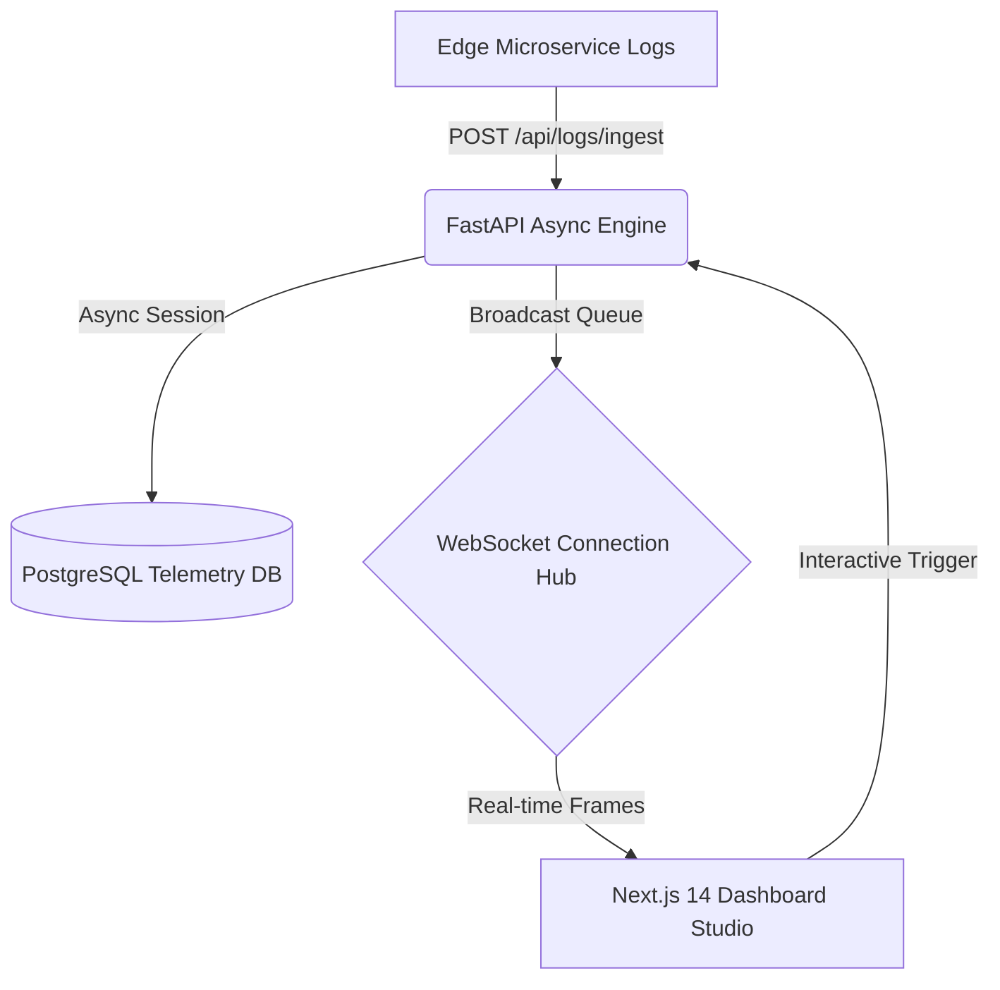

# DevPulse // Real-Time API Analytics & Telemetry Engine


DevPulse is a high-throughput, low-latency API observability and telemetry engine designed for engineering teams needing real-time visibility into microservice latency, status distributions, and error anomalies.

Engineered with a clean, high-density technical interface: dark carbon surfaces (`#0c0d0e`), crisp typography (`JetBrains Mono`), sub-millisecond quantile metrics, and a lightweight, zero-bloat architecture.

---

## Architecture Overview

DevPulse consists of three core layers:

```
┌─────────────────────────────────────────────────────────────┐
│                       Client Apps /                         │
│                  Microservice Edge Proxies                  │
└──────────────┬──────────────────────────────┬───────────────┘
               │ HTTP POST /api/logs/ingest   │
               │ (Async Ingest Stream)        │
               ▼                              │
┌───────────────────────────────────────────┐ │
│         DevPulse Engine (FastAPI)         │ │
│  ┌─────────────────┐  ┌─────────────────┐ │ │
│  │ Async Pipeline  │  │ Quantile Engine │ │ │
│  │  & Validation   │  │ (P50, P90, P99) │ │ │
│  └────────┬────────┘  └─────────────────┘ │ │
│           │                               │ │
│           ├─────────────────────────┐     │ │ WebSocket
│           ▼                         ▼     │ │ Broadcast
│  ┌─────────────────┐      ┌─────────────┴─▼─┴─────────────┐
│  │  PostgreSQL 16  │      │     WebSocket Fanout Hub      │
│  │ Composite BTree │      │       /ws/telemetry           │
│  │     Indexes     │      └───────────────┬───────────────┘
│  └─────────────────┘                      │
└───────────────────────────────────────────┼─────────────────┘
                                            │ Live Event Stream
                                            ▼
┌─────────────────────────────────────────────────────────────┐
│           DevPulse Studio (Next.js 14 App Router)          │
│   • Live Feed Table         • P99 / P50 Latency Meters      │
│   • Multi-Filter Engine     • Status Code Breakdown         │
│   • cURL Replay Inspector   • Traffic Burst Generator       │
└─────────────────────────────────────────────────────────────┘
```



---

## Core Algorithmic Details

### 1. Latency Quantile Estimation ($P_{50}, P_{90}, P_{99}$)
Rather than relying on lossy lossy naive averages, DevPulse computes accurate rank-order quantiles using linear interpolation across sample distributions:
$$k = (N - 1) \cdot \left(\frac{p}{100}\right)$$
$$P_p = V_{\lfloor k \rfloor} + (k - \lfloor k \rfloor) \cdot (V_{\lceil k \rceil} - V_{\lfloor k \rfloor})$$
This guarantees that outlier latency spikes ($P_{99}$) in critical checkout or authentication services are isolated from high-volume health checks.

### 2. Multi-column Composite Indexing Strategy
To enable sub-5ms queries over high-volume audit logs with multidimensional filters, PostgreSQL schemas employ specialized composite B-Tree indexes:
- `ix_audit_logs_timestamp_status (timestamp DESC, status_code)`: Instant time-window status filtering.
- `ix_audit_logs_endpoint_latency (endpoint, latency_ms)`: Fast hotspot identification and percentile grouping.
- `ix_audit_logs_method_status (method, status_code)`: Method-level error rate aggregation.

### 3. Non-Blocking WebSocket Broadcast Fanout
WebSocket transmissions are handled via an asynchronous connection registry (`ConnectionManager`) equipped with automatic dead-connection pruning, backpressure resistance, and heartbeat pong diagnostics to maintain low CPU overhead under high subscriber concurrency.

---

## API Reference

### Log Ingestion & Querying

#### `POST /api/logs/ingest`
Ingests a single API execution trace.
- **Request Body**:
  ```json
  {
    "endpoint": "/api/v1/auth/tokens",
    "method": "POST",
    "status_code": 200,
    "latency_ms": 42.8,
    "payload": "{\"grant_type\": \"password\"}",
    "client_ip": "192.168.1.10",
    "user_agent": "Mozilla/5.0",
    "request_headers": "{\"authorization\": \"Bearer ...\"}",
    "response_body": "{\"access_token\": \"...\"}"
  }
  ```
- **Response**: `201 Created` with full log record and assigned `request_id`.

#### `POST /api/logs/batch`
Bulk ingestion endpoint for high-volume log forwarders (Fluentbit / Vector).
- **Request Body**: `{ "logs": [ ... ] }`

#### `GET /api/logs`
Queries historical logs with pagination and filters.
- **Query Parameters**:
  - `limit` (default: 50, max: 500)
  - `offset` (default: 0)
  - `endpoint` (partial match)
  - `method` (`GET`, `POST`, `PUT`, `DELETE`)
  - `status_code_min`, `status_code_max` (range filters, e.g. `500` to `599`)
  - `min_latency_ms` (threshold filter)
  - `search` (full-text search over endpoint, payload, and error messages)

#### `GET /api/logs/{log_id}`
Retrieves complete details of an individual telemetry record.

---

### Real-Time Telemetry & Aggregation

#### `GET /api/metrics/summary`
Returns system-wide telemetry KPIs:
```json
{
  "total_requests": 65,
  "avg_latency_ms": 118.4,
  "p50_latency_ms": 45.2,
  "p90_latency_ms": 280.0,
  "p99_latency_ms": 1240.0,
  "error_rate_percent": 6.15,
  "status_2xx": 54,
  "status_3xx": 2,
  "status_4xx": 5,
  "status_5xx": 4,
  "requests_per_sec": 12.4,
  "active_ws_clients": 1,
  "slow_endpoints": [ ... ]
}
```

#### `GET /api/metrics/timeseries`
Aggregates time-bucketed observations for throughput and $P_{99}$ latency trend charts.

#### `WS /ws/telemetry`
Live bidirectional streaming endpoint. Emits JSON payloads on every log ingestion:
```json
{
  "type": "log_ingested",
  "log": { ... }
}
```

---

### Simulation & Controls

#### `POST /api/sim/burst`
Generates synthetic traffic bursts for live dashboard demonstration.
- **Payload**: `{ "count": 20, "burst_type": "normal" | "error_spike" | "high_latency" }`

#### `POST /api/sim/reset`
Resets telemetry storage to a clean baseline with seeded fixtures.

---

## Quickstart & Local Development

### 1. Docker Compose (One Command)
Run the complete stack (PostgreSQL + FastAPI + Next.js):
```bash
docker-compose up --build
```
- Dashboard: [http://localhost:3000](http://localhost:3000)
- Backend API Docs: [http://localhost:8000/docs](http://localhost:8000/docs)

---

### 2. Manual Development Setup

#### Backend Setup
```bash
cd backend
python3 -m venv .venv
source .venv/bin/activate
pip install -r requirements.txt

# Start backend server (auto-creates tables and seeds initial data)
uvicorn app.main:app --host 0.0.0.0 --port 8000 --reload
```

#### Running Backend Tests
```bash
cd backend
PYTHONPATH=. pytest tests -v
```

#### Frontend Setup
```bash
cd frontend
npm install
npm run dev
```
Open [http://localhost:3000](http://localhost:3000).

#### Frontend Production Build
```bash
cd frontend
npm run build
```

---

## License
MIT License. Crafted with precision for high-density observability.
